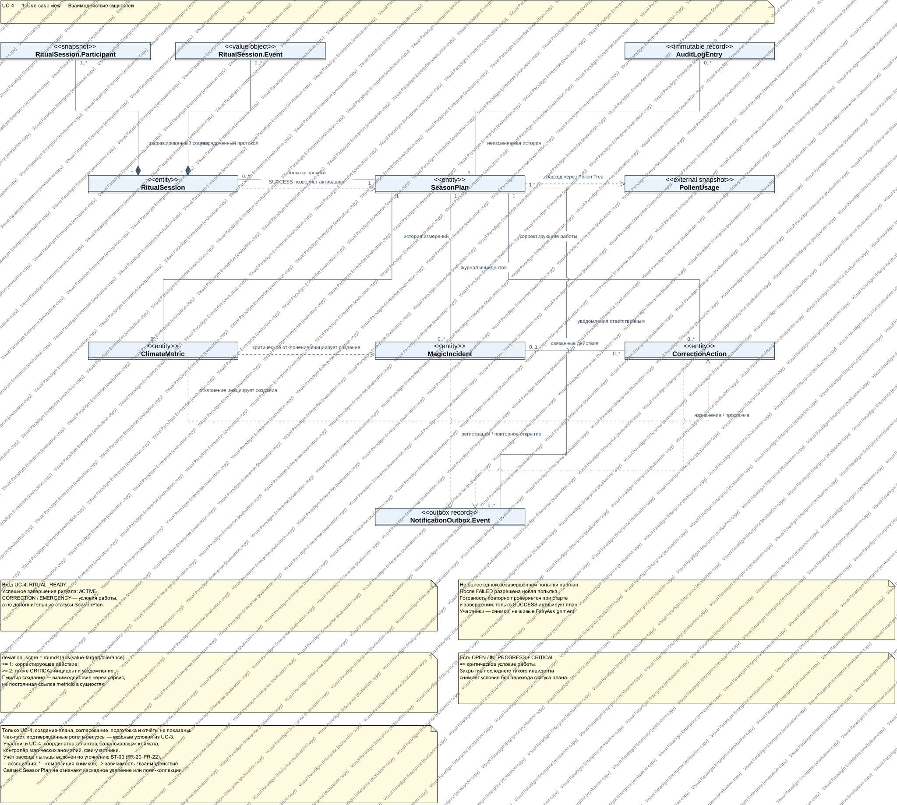
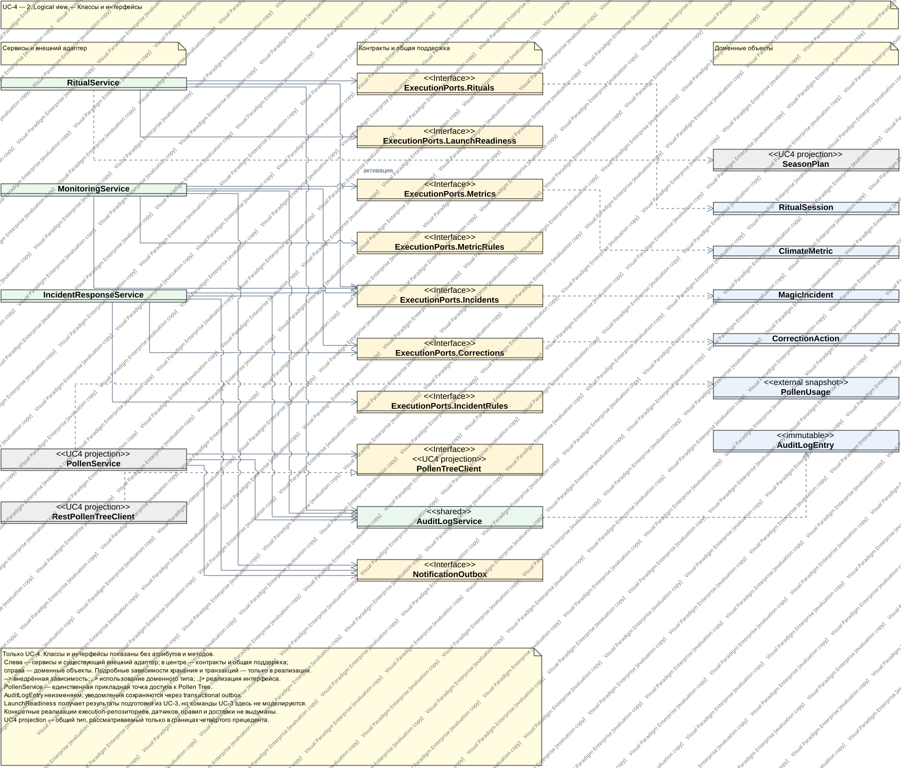

# UC-4 — Выполнение и контроль сезона

## Open the Visual Paradigm project

Open **[SeasonPlan-UC4-movable.vpp](SeasonPlan-UC4-movable.vpp)** in **Visual Paradigm 18.1 or later** using **Project → Open**. This fresh filename avoids reopening an already-cached older project. [SeasonPlan-UC4.vpp](SeasonPlan-UC4.vpp) contains the same repaired project.

No import or plugin is required. The diagrams contain native UML classifiers, attributes, operations and relationships, not embedded images.

Under `UC-4 — SeasonPlan execution`, the project contains exactly three class diagrams:

| View | Assignment requirement | Contents |
| --- | --- | --- |
| **1. Use-case view** | «Взаимодействие сущностей» | Entity interactions, cardinalities, participant/event snapshots, deviation responses, audit and notifications. |
| **2. Logical view** | «Описание основных классов и интерфейсов их взаимодействия» | Application services, domain classes, outbound interfaces, dependency direction and the existing Pollen Tree adapter. |
| **3. Implementation view** | «Полное описание классов с указанием их методов/полей, указать типы связей между классами» | Typed fields, visibility, constructors, public/private methods, parameters, return types, static members, nested records/enums and relationship types. |

Use Diagram Navigator to open each diagram. **The use-case and logical views contain class/interface names only: zero attributes and zero operations, including in their underlying UML models.** Full members belong exclusively to the implementation view.

The logical view is arranged as three columns: services/adapters → contracts/shared support → domain objects. Low-level persistence and transaction dependencies appear only in the implementation view. That detailed diagram groups the ritual, monitoring, incident-response, pollen and shared-support class families; zoom in to inspect members.

If the previous project is still open, close it **without saving the old version** before opening this updated file.

### Moving relationship captions

Click the connector line, then drag its **caption text**, not an arrow endpoint or bend handle. All **62 named relationship captions** now use Visual Paradigm's standard draggable caption mode. Note captions and unnamed relationships were not changed.

The earlier generator forced the wrong caption mode: it rendered the names but the native caption mouse handler rejected selection/dragging. The repair was regression-tested through the installed native Swing caption component's hit-testing and dispatched mouse press/drag/release events: the old mode was not selectable and moved by `(0, 0)`; the repaired mode was selectable and moved by `(60, 30)`. The saved modes were then checked after reopening the native project. This is a native-widget interaction test, not a full desktop GUI automation test.

## Scope and notation

**Only UC-4 is modeled:** ritual attempts and activation, manual/imported climate measurements and history, corrections, incident response, overdue escalation, actual pollen consumption, audit and notification contracts.

- UC-1 planning, UC-2 approval, UC-3 preparation commands, and UC-5 completion/reporting are excluded. Launch readiness and confirmed participants/resources are inputs from preparation, not a second implementation of UC-3.
- Shared classes/interfaces are marked **`UC4 projection`**. Their unrelated operations are deliberately excluded. The implementation view shows all fields and declared operations of the UC-4-specific types; shared projections retain the fields and operations needed to understand this slice.
- Java-generated record accessors, `equals`, `hashCode`, `toString`, enum `values`/`valueOf`, and compiler-generated helpers are implicit. Canonical record constructors and explicitly declared private helpers are shown. JDK/Spring library internals are not expanded.
- Solid lines/arrows are associations; the filled diamond is composition of ritual participant/event snapshots; dashed arrows are usage/creation dependencies; the hollow dashed triangle is interface realization.
- Associations named `seasonPlanId` / `incidentId` use UUID fields, not direct Java object references. The PlantUML text additionally marks them **`{ID reference}`**. Associations with SeasonPlan do not imply cascade deletion. Audit history must remain immutable.
- View-specific subpackages are separate abstractions of the same slice, not three sets of production classes.

### Requirements conflicts resolved by the project

[ST-00](../ST-00-specification-resolution.md) supersedes conflicting passages in the original UC/SRS:

- The UC-4 lifecycle transition is **`RITUAL_READY → ACTIVE`**, only after successful ritual completion and a command-time readiness recheck.
- **`CORRECTION` and `EMERGENCY` are operating conditions, not SeasonPlan statuses.** An operational CRITICAL incident creates the critical condition; resolving the last such incident clears it without a lifecycle transition.
- The implemented metric catalog is `temperature/CELSIUS`, `humidity/PERCENT`, and `pollen_density/G_PER_M3`, not the original SRS migration index.
- `deviation_score = round4(abs(value - target) / tolerance)`. A score ≥ 1 creates a correction action; a score ≥ 2 also creates a CRITICAL incident.
- Actual pollen consumption belongs to UC-4 under ST-00's traceability table (FR-20–FR-22). It must go through **PollenService → PollenTreeClient → Pollen Tree**. Reservation creation/approval and report generation are not included.

### Current implementation, not an invented deployed system

As documented in the [backend README](../../../backend/README.md), execution services are implemented and unit-tested core classes, but UC-4 REST/UI composition, execution persistence, readiness/rule adapters, sensors, a periodic scheduler and durable outbox delivery are not yet integrated. `escalateOverdue()` is a callable method, not an existing scheduled job. The existing JDBC schema is not a complete UC-4 persistence adapter.

The existing `RestPollenTreeClient` implements the external port, but its provider contract remains proposed rather than live-verified. Local transactions cannot roll back external pollen spending; provider idempotency is required.

## Sources and verification

The model was checked against:

- [UC-4 specification](../../../arch_docs/USE_CASE_SPECIFICATION.md), fourth use case only.
- [SRS](../../../arch_docs/SYSTEM_REQUIREMENTS_SPECIFICATION.md), execution requirements and shared prerequisites.
- [ST-00 business-semantics resolution](../ST-00-specification-resolution.md).
- [Execution application classes](../../../backend/src/main/java/com/seasonplan/lifecycle/application/execution), [ports](../../../backend/src/main/java/com/seasonplan/lifecycle/application/port), [domain](../../../backend/src/main/java/com/seasonplan/lifecycle/domain), and the UC-4 portion of [PollenService](../../../backend/src/main/java/com/seasonplan/lifecycle/application/pollen/PollenService.java).
- [Execution use-case tests](../../../backend/src/test/java/com/seasonplan/lifecycle/application/ExecutionUseCaseTest.java) and [domain tests](../../../backend/src/test/java/com/seasonplan/lifecycle/domain/ExecutionDomainTest.java).

Java declarations were extracted from the existing core compiled with `--release 17`; no application code was changed. The native project was saved and reopened through Visual Paradigm's Open API and checked for exactly three class diagrams:

| View | Classifiers | Fields | Operations | Relationships |
| --- | ---: | ---: | ---: | ---: |
| Use-case | 10 | 0 | 0 | 15 |
| Logical | 22 | 0 | 0 | 26 |
| Implementation | 44 | 128 | 127 | 81 |

Enumeration literals are not included in the field count.

The repair was checked against the **saved and reopened native project**, not just relationship counts:

- All **122 connectors** have the correct semantic and diagram endpoints, with both ends on the intended class perimeter.
- Routes are orthogonal; classifiers do not overlap; no route passes through an unrelated classifier's interior.
- Class bounds and the implementation view's field types, parameter names/types and return types survive reopening.
- A disposable-copy smoke test moved one classifier in each diagram and rebuilt its connectors: all **23 affected connections** remained attached after rebuilding.
- The SVG previews below were exported from the reopened `.vpp` and visually inspected.

[Native-file validation results and project SHA-256](validation.json). Independent visual review of the native exports found no remaining issues after the caption repair.

Runtime tests were not rerun: this is a documentation-only change.

## Supplemental previews and editable text sources

**These SVGs are actual Visual Paradigm exports of the reopened native project**, so they show its saved class positions and connector routing. The local Visual Paradigm installation is in evaluation mode; its evaluation watermarks remain in the exports. They were not removed.

The accompanying PlantUML sources describe the same three levels of abstraction and can be edited/rendered separately; their automatic layout is not used as evidence that native connectors are correct. No application/build dependency was added.

### 1. Use-case view

[PlantUML source](01-use-case-view.puml) · [Open SVG](01-use-case-view.svg)

### 2. Logical view

[PlantUML source](02-logical-view.puml) · [Open SVG](02-logical-view.svg)

### 3. Implementation view

[PlantUML source](03-implementation-view.puml) · [Open SVG — zoom for member details](03-implementation-view.svg)

